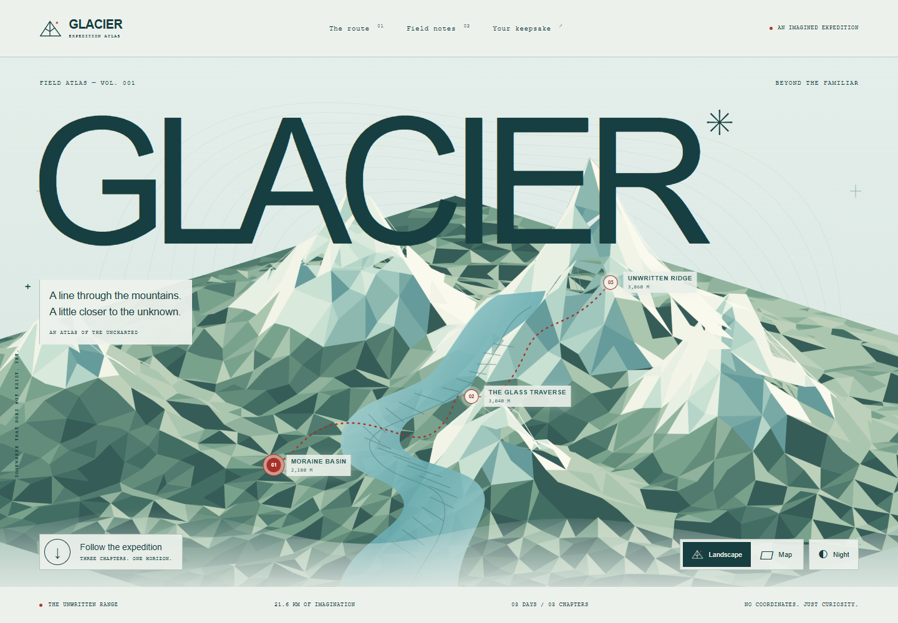

# GLACIER — an atlas of the uncharted

An original portfolio experience: an artistic atlas of an imagined alpine expedition, from moraine basin to the white horizon. Cold snow tones, procedural faceted terrain, topographic contours, red route markers and editorial typography.



## Explore

- Original deterministic SVG massif, glacier, contour survey and illustrated field journal. No WebGL or render loop.
- Landscape / map and day / night palettes. Three chapter markers and a fictional elevation study.
- Chapter state reflected in browser history and optionally saved in versioned local storage. Invalid or blocked storage is recoverable.
- Three connected journal entries and a chapter-specific SVG expedition card download. Reset is local and immediate.
- Keyboard controls, visible focus, reduced motion, responsive 320px through desktop and landscape layouts.

## Fiction

This is a work of fiction. Every place, terrain form, route, distance, altitude and expedition entry is invented for an artistic story. No real coordinates are provided. The site is not navigation, weather or safety guidance, and does not offer travel bookings. Numerical route and elevation labels exist only inside the fictional narrative.

## Run locally

Node.js 24 and npm:

```sh
npm ci
npm run dev
```

Open `http://127.0.0.1:4186/glacier-atlas/`. Build with `npm run build`; production preview with `npm run preview`. The base path is set for `seoshiro/glacier-atlas` GitHub Pages.

```sh
npm run lint
npm run typecheck
npm test
npm run test:e2e
```

Browser tests use one Playwright worker and existing Google Chrome. Windows default: `C:\Program Files\Google\Chrome\Application\chrome.exe`. Set `CHROME_PATH` for another existing Chrome installation. CI uses the runner's preinstalled `/usr/bin/google-chrome` and does not install Chrome through apt. Set `BASE_URL` for live checks. Unit tests cover storage, export, URL parsing and terrain geometry.

## Assets and licensing

All terrain geometry, SVG art, favicon, field drawings, copy, layout and expedition card were created for GLACIER. No stock photos, external fonts, paid services, API keys or remote runtime assets. Typography uses system Arial/Helvetica, Georgia and Courier New. Project source and original assets are MIT licensed; dependencies retain their own licenses (`npm ls --all` / package metadata). React and Vite are MIT licensed; TypeScript and Playwright use Apache-2.0; axe-core uses MPL-2.0.

## Scope and limits

This is a static frontend. Local storage remains in the current browser; it is not account sync. SVG download availability depends on browser download permissions. No analytics, trackers, backend, authentication, payments, sound or network APIs. Terrain is static SVG and transitions are CSS; no GPU animation, continuous requestAnimationFrame or DPR-dependent Canvas allocation. See [QA report](qa/REPORT.md) for measured conditions, executed checks and remaining limits. Automated browser evidence does not substitute for physical-device or human assistive-technology testing.

## Deployment

The GitHub Actions workflow runs lint, types, unit, build and Chrome E2E before deploying the static `dist` artifact to free GitHub Pages. Roll back by reverting the relevant commit and letting the same checks redeploy. No credentials are stored in the project.
